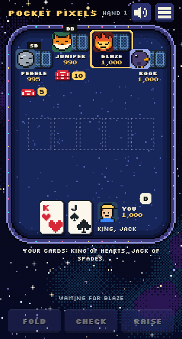

# Pocket Pixels

An 8-bit Texas Hold'em game for your phone. Play solo against up to four computer opponents, each with their own face and playing style, or open a table and send the link to friends.

**Play it: [ethanmanco.github.io/pocket-pixels](https://ethanmanco.github.io/pocket-pixels/)**

<p align="center">
  
</p>

Play chips only. There is no real money, nothing to buy, and no ads.

## What it does

- **No-limit Texas Hold'em** against 1 to 4 computer opponents (5 players by default). Blinds of 5 and 10 move around the table with the dealer button, through pre-flop, flop, turn, river and showdown.
- **Your moves:** fold, check, call, or raise with a slider plus quick buttons for the minimum, half the pot, the pot, or all in.
- **Real poker rules:** correct hand ranking with kickers, ties and split pots, side pots when players go all in for different amounts, minimum raise rules, and unmatched bets returned.
- **Showdown:** the winning five cards are outlined and the hand is named, for example "Flush, king high" or "Pair of kings, ace kicker".
- **Chips you can see:** every bet sits in front of the player as a stack of pixel chips, bets slide into the pot at the end of each round, and the pot slides to the winner.
- **Saved on your phone:** your chips and stats (hands played, hands won, biggest pot, best hand, rebuys). Go broke and a Rebuy button gives you 1,000 more.
- **Sound:** short chiptune effects for dealing, chips, checks, folds and wins, with a mute button that is remembered.
- **Play with friends:** open the menu, tap New table, and share the link (or the 5-letter code). Up to five players per table; the host can fill empty seats with bots. Each player gets 30 seconds to act, and someone who drops out sits out until they return.
- **Installable:** add it to your home screen and solo play works offline.

## How the opponents decide

Each opponent only ever sees what a real player at the table would see: its own two cards, the board, and everyone's chip counts and bets. The game hands them a "player view" that leaves out the deck and every other player's cards, and a test checks that nothing hidden leaks into it.

On its turn, an opponent:

1. **Estimates its hand strength** by dealing out the rest of the hand about 300 times at random against the players still in, and counting how often it would win.
2. **Checks the pot odds:** how much it has to put in compared with how much it could win.
3. **Considers position:** it plays a little looser on the dealer button, where it acts last.
4. **Adds a little randomness**, so the same spot does not always get the same answer.
5. **Applies its personality**, which shifts how many hands it plays, how often it raises, how often it bluffs, and how big it bets:

| Opponent | Style | How it plays |
| --- | --- | --- |
| Pebble | Cautious | Plays few hands, rarely bluffs, gives up when you push back. |
| Juniper | Loose | Plays lots of hands and calls too much, but seldom raises. |
| Blaze | Aggressive | Raises often, bets big and bluffs more than it should. |
| Rook | Steady | Sensible hands, sensible bets, the odd bluff. |

Each style has a weakness you can use, so none of them is unbeatable.

## How it's built

- **Vite + TypeScript**, no framework.
- **Plain DOM instead of Canvas.** Cards, seats and buttons are real elements, so screen readers can read them ("Your cards: ace of spades, king of hearts") and every button is a large, real tap target. Animations use CSS transforms, which stay smooth on older phones.
- **Art made in code.** Cards, suits, chips, avatars, the table and the app icon are all drawn from small pixel maps written for this project, and turned into crisp SVGs at runtime. Suits differ by shape as well as color (a four-color deck), so they never rely on color alone.
- **Sound made in code.** Every effect is synthesized with the Web Audio API from square and triangle waves and a little noise. There are no audio files.
- **Game logic separate from the display.** `src/engine` (cards, hand ranking, betting, pots, bots) has no DOM code and is tested on its own. Every engine function takes a state and returns a new state plus a list of events, which the display turns into animations and sound.
- **One screen, two sources.** The table screen only draws what a source sends it and passes your moves back. Solo play uses a local source that runs the engine and bots on the phone; online play uses a WebSocket to the table server.
- **Respects reduced motion.** With your phone's reduce motion setting on, cards and chips appear without sliding or flipping.
- **Offline:** a service worker (vite-plugin-pwa) caches the game and its font.

### Online tables

The table server is a small [Cloudflare Worker](https://developers.cloudflare.com/workers/) in `server/`, using one [Durable Object](https://developers.cloudflare.com/durable-objects/) per table code. It runs the same engine as solo play, so the deck only ever exists on the server:

- Each phone receives only its own view of the table: its own cards, the board, chip counts, and cards turned face up at showdown. The same view function is tested to never leak a hidden card.
- Bots, turn timers and dealing run on the server with Durable Object alarms. Between moves the object hibernates, so an idle table costs nothing.
- Messages from phones are checked before use, names are cleaned to letters and numbers, and only the game's own pages may connect.
- A phone that reconnects gets its seat back with a token kept on the phone.

It fits comfortably in Cloudflare's free plan (100,000 Durable Object requests a day; going over fails with an error rather than costing money).

### Tests

112 tests with Vitest, including:

- every hand category, the kicker at every position, exact ties, the board playing for everyone, and the wheel (A-2-3-4-5), including that it loses to a six-high straight;
- a fast evaluator used by the bots, checked against the full one on 5,000 random hands;
- side pots with two and three all-ins of different sizes, folded chips staying in the pot, split pots with odd chips going to the player left of the button, and uncalled bets coming back;
- heads-up blind order, minimum raises, and short all-ins that do not reopen the betting;
- 500 hands of random play at 2 to 6 players checking that no chip is ever created or lost;
- that a player's view never includes the deck or anyone else's cards;
- saving and loading when storage is empty, broken, tampered with, or blocked;
- online tables: seating, reconnecting, the host's controls, turn timeouts, sitting out, leaving mid-hand, and that each phone's update holds only its own cards.

`npm run check:online` runs an end-to-end test in which two headless browsers play a table against each other and a bot.

## Run it yourself

```bash
npm install
npm run dev      # play at http://localhost:5173
npm test         # run the tests
npm run build    # production build in dist/
```

Online play locally:

```bash
npm run server:local   # table server and a test build of the game at http://localhost:8787
```

Open `http://localhost:8787/?table=ABCDE` in two browsers (or on phones on the same Wi-Fi) to play each other. Deploy the server to Cloudflare with `npx wrangler login` once, then `npm run deploy:server`.

Other scripts: `npm run icons` redraws the app icons, and `npm run demo` re-records `docs/demo.gif` (it needs the dev server running and Chrome installed).

Pushing to `main` runs the tests, builds the site and deploys it to GitHub Pages with GitHub Actions.

## Future ideas

Not in this version, but on the list:

- Chat or emoji reactions at online tables
- Tournaments with rising blinds
- Other poker games, such as Omaha
- Accounts and leaderboards
- Hand history and replays

There will never be real money, purchases or anything resembling real gambling.

## Credits

- Font: [Silkscreen](https://github.com/googlefonts/silkscreen), Copyright 2001 The Silkscreen Project Authors, licensed under the [SIL Open Font License 1.1](https://openfontlicense.org). Bundled through [Fontsource](https://fontsource.org/fonts/silkscreen).
- All pixel art and sound effects were made in code for this project.

Built with Claude Code. I designed, directed, reviewed, and tested it.
